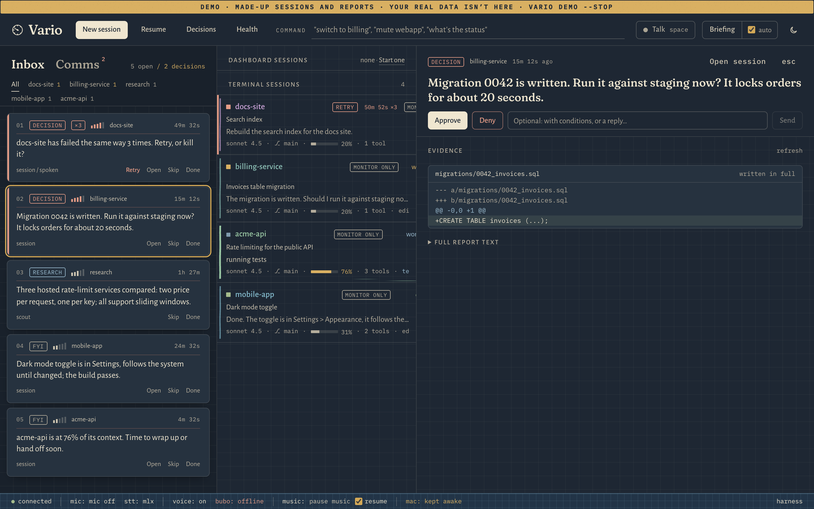
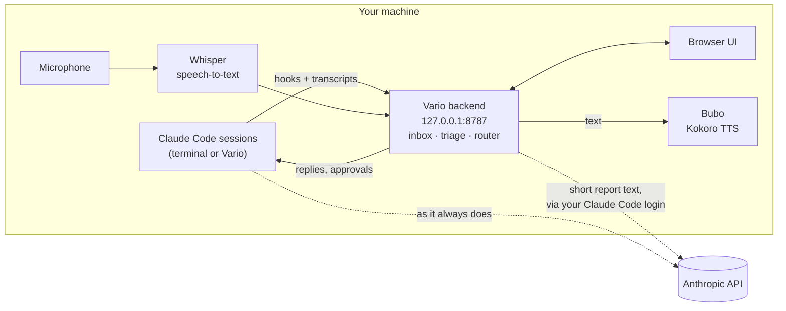

# Vario

[](LICENSE)

[](https://github.com/chemwor/vario/actions/workflows/ci.yml)
[](CHANGELOG.md)

<!-- GIF: a 20-second loop. A decision arrives, its evidence opens, a spoken "approve" goes through the confirm
     card, and the session carries on to done. `make demo-gif` records it from a fresh `vario demo` (made-up data)
     and writes docs/vario.gif. Replace this comment with:  -->

**A decision inbox for people running many Claude Code sessions at once, with a voice that runs on your own
machine.** Dashboards for agents usually show you sessions: tabs to watch, logs to scroll. Vario shows you
*decisions*. Every permission prompt, question, error and finished turn, from every session, becomes a report
that a small model triages into "needs you", "research" or "fyi". Then Vario puts the ones that need you first,
reads them to you, and takes your spoken answer back to the right session. Speech in and out is local: Whisper
transcribes on your machine, Kokoro speaks on your machine, and no audio ever leaves it. You can look away from
the screen and still unblock five agents.


<sub>The inbox (night theme, `vario demo` data): a decision selected, with the file it wrote as evidence.</sub>

### How it sounds

> **Vario:** billing-service: Migration 0042 is written. Run it against staging now? It locks orders for about 20 seconds.<br>
> **You:** Approve.<br>
> **Vario:** Approving billing-service. Sent to billing-service.

Vario is an opinionated personal tool, shared as-is. It runs on **macOS (Apple Silicon)** and **Linux**.
**Windows isn't supported** in v0.1 (WSL may work, untested).

## Quickstart (60 seconds)

**Requirements:** macOS 13+ on Apple Silicon, or Linux · about 2 GB of disk for the voice models · Claude Code
installed and logged in · uv and jq.

Get [Claude Code](https://docs.claude.com/claude-code), [uv](https://docs.astral.sh/uv/) and `jq` first if you don't have them.

```bash
curl -fsSL https://raw.githubusercontent.com/chemwor/vario/main/install.sh | bash
```

or, with Homebrew:

```bash
brew install chemwor/vario/vario && vario
```

Vario opens in your browser at `http://127.0.0.1:8787` with a setup wizard:

1. **Dependencies:** what's present, and the command to fix anything that isn't.
2. **Voice models:** Kokoro (355 MB) and Whisper (481 MB) download here, not during install. Each file is checked
   against a pinned sha256.
3. **Claude Code hooks:** you see the exact change to `~/.claude/settings.json` and tick a box before it's written.
4. **Test sound, microphone, theme and voice.**

Every step can be skipped. Skipped steps show up under **Health** until you come back to them. Then start a
Claude Code session anywhere (`claude` in a terminal, or **New session** in Vario) and Vario picks it up.

Want to look around first? `vario demo` opens a separate copy filled with made-up sessions and reports, marked
DEMO, without touching your real data.

## What you get

- **Inbox:** decisions first, then urgency, then age. Identical errors from one session collapse into one
  report with a count; the third repeat asks "Retry, or kill it?".
- **Spoken alerts:** an urgent decision is spoken right away ("billing-service: OK to run the migration?") and
  repeats every few minutes until it's answered. Everything else waits for a briefing. If the voice can't speak
  (no speakers, daemon down, Linux without Kokoro), you get a desktop notification instead.
- **Briefing mode:** Vario reads the queue aloud, listens after each item, routes your answer ("approve",
  "tell it to use staging", "skip", "scout: compare hosted rate limiters"), confirms what it did, and moves on.
- **Session board:** dashboard sessions and terminal sessions side by side, ordered error → blocked → working →
  done. Each shows a context meter, how its last turn went (done / done-check / failed) and stuck detection, and
  each decision has an evidence panel with the diff or command it's about.
- **Decision log:** every answer is recorded: what you said, the action it became and where it was routed.
  Filter it by project and copy it as Markdown.
- **Safe by default:** a confidence gate means mumbles are never acted on. See [the gate](#the-confidence-gate).
- **Research on your product:** from any session, run competition, market, features or end-user research about
  the product that session is building. Vario hands the scout the project's README and what the session is
  working on; the report lands in the inbox, is saved as markdown in `~/Vario/research/<product>/`, and one
  click hands it to the session ("read this, then propose a plan"). Each kind is a markdown playbook you can
  edit. Off in the work profile.

## Why not a session dashboard?

Happy, Omnara, claude-view and Claude Code's built-in agents view are good tools, and they organize *sessions*:
what each agent is doing, its log, its cost. Vario organizes *decisions*: one queue of what needs you, across
every session, in priority order. Where those tools offer voice (Happy, Omnara), it runs through a hosted voice
service; Vario's speech in and out runs on your machine. And every answer you give lands in an auditable
decision log.

## How it works



- **Sources.** Claude Code hooks (`SessionStart`, `Stop`, `Notification`, `SessionEnd`) post events, and Vario
  tails session transcripts in `~/.claude/projects`. Files dropped in `~/Vario/inbox` become reports too.
- **Triage and routing.** A small Claude model (through the Agent SDK, using your Claude Code login) labels each
  report and, when simple local rules can't, works out what a spoken answer means.
- **Replies.** Sessions Vario started (through the Agent SDK) take approvals and messages directly. Terminal
  sessions running in tmux (or cmux) get your reply typed into their pane. Other terminal sessions are
  **monitor-only**: you see and hear them, and answer them in their own terminal.
- **One process.** The backend serves the UI on the same port. Nothing needs Node at runtime.

Internals (report schema, delivery rules, briefing, routing, scouts, profiles, speech-to-text):
[docs/reference.md](docs/reference.md).

## The confidence gate

Voice control of agents that can run commands has to fail safe. Whisper reports a confidence for each
transcription, and Vario uses it:

| Heard at | What happens |
|---|---|
| under 40% | Logged as *rejected: low confidence*. Never acted on: not parsed as a command, not sent to the classifier. |
| 40–70%, approve / deny / yes / no / skip / retry, or anything sent to a session | A confirm card appears and waits for a spoken "confirm" or a click. **Silence never sends it.** |
| 40%+ for anything else, or 70%+ | A short confirm card (2 s by default) that "no", "cancel" or Esc stops; silence sends it. |

Gibberish that clears 40% is labelled *unintelligible* by the classifier rather than guessed into a command.
Every utterance and its outcome is listed in the Comms pane. The thresholds live in `voice.conf`
(`MIN_DISPATCH_CONF`, `STRICT_CONF`) and are on by default. [SECURITY.md](SECURITY.md) explains why.

## The `vario` command

| | |
|---|---|
| `vario` | start (if needed) and open the dashboard |
| `vario stop` / `vario status` | stop it / is it running, setup and hooks state |
| `vario doctor [--deep]` | every check, pass / warn / fail; `--deep` re-verifies model checksums |
| `vario demo [--stop]` | a separate instance with made-up data |
| `vario mute` / `vario unmute` | silence all speech / turn it back on |
| `vario voice [list \| restart \| NAME [SPEED]]` | show or change the voice |
| `vario autostart on\|off` | start at login (LaunchAgent on macOS, systemd user unit on Linux) |
| `vario logs` | follow the log |
| `vario uninstall [--data] [--models]` | remove it (below) |

## Configuration

Two plain-text files, both re-read without restarting where noted. You can edit them by hand. The wizard and
`vario voice` write to the same files.

**`~/.local/share/vario/vario.conf`**: the app (restart with `vario stop && vario` after changes).

| Key | Default | |
|---|---|---|
| `PROFILE` | `personal` | `work`: scouts off, local speech-to-text only, triage only through the Claude login (never an API key) |
| `STT` | `local` | `webspeech` uses the browser's speech service instead (sends audio to Google; ignored in `work`) |
| `STT_ENGINE` / `STT_MODEL` | `auto` / `mlx-community/whisper-small.en-mlx` | `whispercpp` + `WHISPER_CPP_MODEL=/path/ggml-small.en.bin` on Linux |
| `STT_VOCAB` | | extra words Whisper should expect (session names are automatic) |
| `SCOUTS` | `on` | `off` hides research scouts |
| `STUCK_MINUTES` | `10` | a working session with no tool activity this long is marked "possibly stuck" |
| `RETRY_MESSAGE` | `That last attempt failed ({error}). Please try it again.` | what Retry types into a session |
| `CONTEXT_WINDOW` | auto | tokens per session; a session crossing 90% files a wrap-up report |
| `COMMS_RETENTION_DAYS` | `3` | ignored utterances are deleted after this many days |
| `FLIGHT_SPEAK` | `off` | aviation wording for states (in flight / holding / landed); source builds only |

**`~/.claude/hooks/voice.conf`**: the voice, shared with the hooks (read fresh on every line spoken).

| Key | Default | |
|---|---|---|
| `VOICE` / `SPEED` | `af_heart` / `1.2` | `vario voice list` |
| `VOICE_NAME` | `Athena` | what the briefing voice calls itself |
| `NOTIFY` | `fallback` | desktop notifications: `fallback` (when speech fails), `also`, `only` (voice-free), `off` |
| `MIN_DISPATCH_CONF` / `STRICT_CONF` | `0.40` / `0.70` | the confidence gate |
| `EXPLICIT_HOLD_S` | `60` | how long a low-confidence confirm card waits |
| `CONFIRM_HOLD_MS` / `CONFIRM_FAST` / `CONFIRM_READBACK` | `2000` / `yes,no,…` / `on` | the ordinary confirm card |
| `MUSIC` / `MUSIC_RESUME` | `off` / `on` | pause Spotify / Apple Music while speaking (macOS) |
| `VARIO_URL` | `http://127.0.0.1:8787` | where the hooks post (set by setup) |

Environment variables: `VARIO_HOME` (default `~/.local/share/vario`), `VARIO_PORT` (default `8787`),
`VARIO_DIR` (drop folder, default `~/Vario`). An environment variable wins over the same key in `vario.conf`.

## Privacy

- **No telemetry of any kind.** Vario doesn't phone home, count anything or check for updates. It also turns
  off the telemetry of the tools it runs (Next.js, Hugging Face).
- Your microphone audio and Vario's speech never leave your machine. What does, and why, is in
  [SECURITY.md](SECURITY.md).
- Data lives in `~/.local/share/vario`, the hooks in `~/.claude/hooks`, models in `~/.local/share/claude-voice`
  and `~/.cache/huggingface`.

## Uninstall

```bash
vario uninstall            # hooks (exactly the entries setup added), autostart, the app and the command
vario uninstall --data     # ...and your reports, decision log and config
vario uninstall --models   # ...and the voice runtime and models (~2 GB)
```

It shows the `settings.json` change before making it and backs the file up first. Hooks you added yourself
are left alone. With Homebrew, finish with `brew uninstall vario`.

## FAQ

**Does it work without voice?** Yes. Set `NOTIFY=only` in `voice.conf` and every alert becomes a desktop
notification. Approve, deny and reply from the dashboard. Voice is a layer, never a requirement.

**Does it cost anything?** Triage and routing use a small Claude model through your existing Claude Code
login, a few short calls per report. Scouts are full research sessions (about $0.15 each, capped at $1).

**Can it answer sessions in my terminal?** If the session runs in tmux (or cmux), yes. Otherwise it's marked
monitor-only. To make terminal sessions replyable, start them inside tmux (`alias claude='tmux new -A -s
claude-$(basename $PWD) claude'`), or start them from Vario with **New session**.

**Linux?** Supported: dashboard, hooks, notifications (notify-send), keep-awake (systemd-inhibit), speech via
espeak-ng, speech-to-text via whisper.cpp. The Kokoro voice needs Apple Silicon in v0.1.

**Can I reach it from my phone?** Not in v0.1. Vario listens on 127.0.0.1 only and has no remote access. See
SECURITY.md.

**Which Claude Code versions?** The one in [tested-claude-version.txt](tested-claude-version.txt), checked
weekly by CI. `vario doctor` warns when yours is newer.

**Something's wrong.** Run `vario doctor`, then open an issue with its output.

## Development

```bash
git clone https://github.com/chemwor/vario && cd vario
make setup    # uv venv + npm ci
make dev      # API on :8787 with reload, UI dev server on :3000
make check    # lint + types        make test   # backend tests
```

[CONTRIBUTING.md](CONTRIBUTING.md) explains how the project is maintained. [CHANGELOG.md](CHANGELOG.md) lists
the changes.

## License

[MIT](LICENSE)

---

Built by Eric Chemwor · [Astro Digital Labs](https://astrodigitallabs.com/vario)

**Acknowledgments:** [Kokoro](https://huggingface.co/hexgrad/Kokoro-82M) for the voice,
[Whisper](https://github.com/openai/whisper) for speech-to-text, and [mlx-audio](https://github.com/Blaizzy/mlx-audio)
for running them on Apple Silicon.
