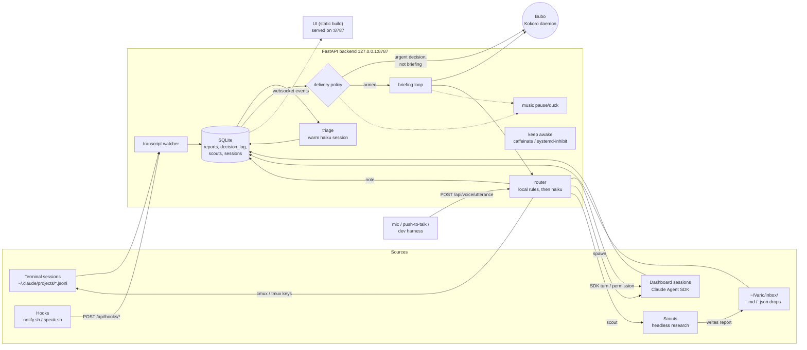
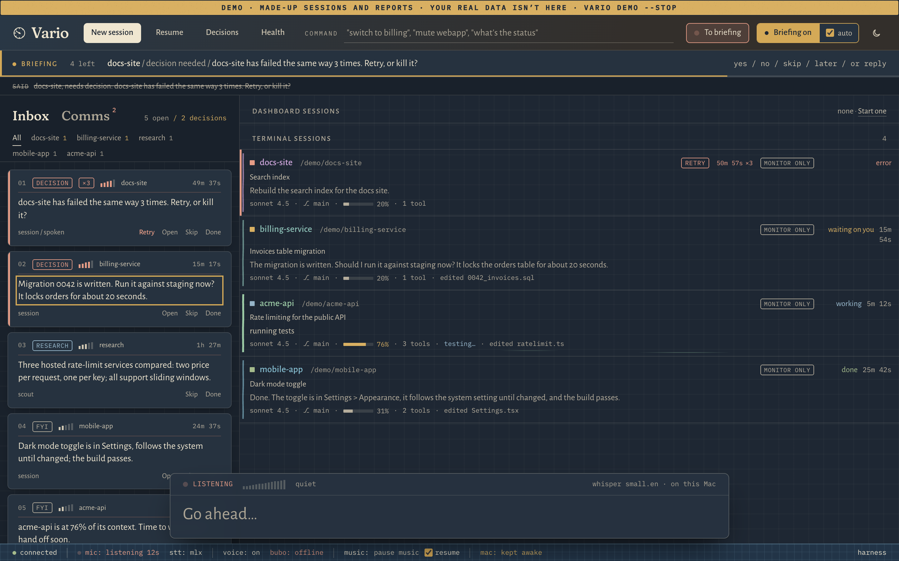

# Vario reference

How Vario works inside: reports, delivery, briefing, routing, scouts, profiles and speech-to-text.
The [README](../README.md) covers installing and everyday use.

## Architecture



| Module (`backend/app/`) | Role |
|---|---|
| `terminal.py` | Tails transcripts of sessions started in a terminal, tracks pending tool calls, and handles Notification/Stop hook events |
| `sessions.py` | Dashboard-owned sessions through the Agent SDK (`acceptEdits`, permissions via `can_use_tool`) |
| `session_reports.py` | Turns session events (blocked, finished, errored, moved on) into reports |
| `alerts.py` | Permission-ask templates plus the warm haiku session (`compressor`) |
| `reports.py` | Report lifecycle, triage worker, delivery policy, reminders |
| `inbox.py` | Watches `~/Vario/inbox/`, ingests files, archives them to `archive/YYYY-MM-DD/` |
| `briefing.py` | Briefing state machine |
| `router.py` | One classify/route pipeline for every utterance |
| `reach.py` | Delivers replies to terminal sessions (cmux, tmux) |
| `scouts.py` | Research sessions that report back through the inbox |
| `music.py` | Pauses or ducks Spotify / Apple Music when Vario talks to you |
| `awake.py` | Keeps the machine awake (through `host.py`) while work is in flight |
| `host.py` | The macOS / Linux differences: sound, keep-awake, notifications, fallback speech, opening URLs |
| `firstrun.py` | The setup wizard's checks and actions; hook install / uninstall with an exact settings.json diff |
| `cli.py` | The `vario` command |
| `demo.py` | `vario demo`: made-up sessions and reports in a separate data folder |
| `voice.py` | Bubo client: speak, stop, busy/idle status |

### Websocket events (`/ws`, server → browser)

`snapshot`, `session_state`, `session_removed`, `message_delta`, `tool_activity`, `speak`, `alert`,
`report`, `briefing_state`, `reply_sent`, `scout`, `awake`, `tts_status`, `permission_request`.
Browser → server traffic goes over REST.

## Report schema

| Column | Values |
|---|---|
| `id` | integer |
| `source` | `session` · `scout` · `app_drop` · `system` |
| `project` | project / directory name (spoken prefix) |
| `type` | `decision_needed` · `research` · `fyi` |
| `urgency` | 1-5 (5 = blocking right now, 4 = needs a decision, 3 = today, 2 = normal, 1 = low) |
| `summary` | one sentence written to be spoken aloud |
| `body` | full text (transcript excerpt, file contents, scout report) |
| `created_at` | unix time |
| `status` | `queued` → `delivered` (spoken) → `answered` · `skipped` |
| `decision_text` | what was decided ("approve: yes", "answered in terminal", ...) |
| `decision_routed_to` | session id, `cmux:<surface>`, `tmux:<pane>`, `scout:<id>`, `decision_log`, `dashboard` |

Bookkeeping columns: `session_id`, `dedupe_key` (unique: one report per event, e.g. `block:<tool_use_id>`),
`triaged`, `delivered_at`, `reminders`, `answered_at`, `snoozed_until`.

Queue order everywhere is **decision_needed first, then urgency (high first), then age (oldest first)**.

### Where reports come from

| Event | Report |
|---|---|
| Permission prompt (SDK `can_use_tool`, or the Notification hook plus the pending tool call in the transcript) | `decision_needed` u4, e.g. "billing: OK to run the database migration?" |
| Turn ends with a question | `decision_needed` u4, the question |
| Turn ends normally | `fyi` u2, "done. …" (empty turns are not reported) |
| API error / failed turn | `decision_needed` u4, "error, …" |
| File dropped in the inbox | triaged by haiku; fallback is `fyi`, u2, first line |
| Scout finished | always `research`; bumps the linked decision's urgency by 1 |

Triage makes one haiku call per report (about 1.5s on a warm session; a cold `claude -p` takes about 10s).
Permission asks are spoken before triage, from a template, so they're never held up by the LLM.

### Inbox drop format

`.json`: `{"project", "summary", "body", "type", "urgency"}`, all optional except some text.
`.md`: optional front matter, then the body:

```markdown
---
project: billing
type: decision_needed      # optional hint; triage decides
urgency: 3
---
Should we renew the TLS certificate manually or move to automatic renewal?
```

A `billing--anything.md` filename also sets the project.

## Delivery rules

- **Outside briefing mode:** a `decision_needed` report with urgency ≥ 4 is spoken at once
  ("billing: OK to run the migration?"). If it's still open, it repeats every 3 minutes
  ("Still waiting: billing. …"), at most 5 times. Everything else waits quietly in the queue.
- **While briefing is armed:** the briefing loop owns all delivery. Immediate alerts and reminders are
  suspended, so nothing doubles up.
- **Mute:** global mute (`vario mute`, the 🔊 button, or `~/.claude/hooks/.muted`) silences everything.
  Per-session 🔇 mutes that session's alerts. Per-session 💬 turns on narration of every assistant
  message (off by default).
- **Music:** before speaking to you, Vario pauses (default) or lowers Spotify / Apple Music.
  Music comes back once the speech (and any open mic) is done ("resume after", on by default).
  Dashboard sessions' questions keep it paused until you answer. In briefing it pauses only while a
  report is being read, the mic is open or your answer is handled, and comes back when the queue is
  empty. Terminal sessions never wait for an answer. It only controls apps that are already running. The first time, macOS asks you to allow automation; click OK.

## Briefing mode



Arm it with the **▶ Briefing** button, **⌘⇧B**, or by saying "start briefing"; Athena answers
"Athena online" with the queue count. Disarm with "stop briefing" ("Athena standing by").
With **auto** ticked (next to the button, on by default) a new report arms briefing by itself while a
dashboard tab is open; an auto-armed briefing turns off again when the last tab closes.

1. **speaking:** "billing, needs decision: approve the invoices migration?" The mic is closed.
2. **listening:** once playback has finished (Bubo reports busy/idle), a chime plays and the mic
   opens for 15s (`BRIEFING_LISTEN_S`). Silence moves on and leaves the report queued.
3. **routing:** the router handles the utterance (below).
4. **speaking:** a confirmation ("Approved. Sent to billing."), then the next report.

When the queue is empty, briefing waits and reads new reports as they arrive. When a scout's research
lands, it's read next, and the decision it informs comes straight back up.

## Routing rules

Every voice path (briefing auto-listen, hold-Space push-to-talk, the command bar, and the
**dev harness**) posts to `POST /api/voice/utterance`. The harness runs exactly the pipeline the mic uses.

**Which report an utterance answers:**
1. In briefing: the report being read.
2. A leading project name overrides it: "billing, yes go ahead" answers billing's most urgent open decision.
3. Outside briefing: the selected dashboard session; otherwise the **most recently alerted** session's
   open decision; otherwise it's treated as a command.

**Classification:** local rules first, with no LLM.

| Said | Action |
|---|---|
| yes / yeah / ok / approve / go ahead / do it | `approve` |
| "yes, but use staging" | `approve` + instructions |
| no / nope / deny / don't | `deny` |
| "no, deploy to staging only" | `deny` + instructions |
| skip | `skip` (report marked skipped) |
| next | `next` (report stays queued) |
| later / snooze / not now | `later` (snoozed 30 min) |
| mute | mute that session's alerts |
| stop briefing / that's all | disarm |
| note that … / remember … | `note` (decision log) |
| scout: … / research … | `scout` (linked to the current decision) |

Anything else goes to **one haiku call**, which returns `{action: approve|deny|reply|spawn|scout|note|later|skip, text, project}`.

**Delivery:**

| Session type | approve / deny | reply |
|---|---|---|
| Dashboard (SDK) with a pending permission | resolves the permission (deny can carry a message) | denies with your text as instructions |
| Dashboard (SDK), no permission pending | sends "Yes, go ahead." / "No…" as the next turn | sends as the next turn |
| Terminal in **tmux** | Enter / Escape + text via `send-keys` | types the text + Enter |
| Terminal in **cmux** | Enter / Escape + text via `cmux send-key` / `send` | types the text + Enter |
| Unreachable terminal | "billing needs you in its terminal" (report stays open) | same |
| No session (inbox drop) | closes the report | recorded as a note |

`spawn` starts a new SDK session in the report's project. `scout` launches a scout.

**cmux safety:** before pressing anything, the router reads the pane's screen. Enter / Escape are sent
only if a permission dialog is the *last* thing on screen. A reply is typed only if no dialog is showing.
Otherwise it sends nothing and tells you why. The pane is found from the `--session-id` that cmux passes
to `claude`, plus `CMUX_SURFACE_ID` in that process's environment. Only that variable is read; the cmux
socket token in the same environment is never logged.

## Scouts

A scout is a headless research session (model `SCOUT_MODEL`, default sonnet; `SCOUT_BUDGET_USD`,
default $1; 30 turns; 15 min). It may only use WebSearch, WebFetch, and Write to its own report file.
The report is moved atomically into `~/Vario/inbox/`. Template:

```
---
source: scout · project · type: research · scout_id · summary: <one spoken sentence>
---
# Question · ## Findings · ## Sources · ## Recommendation · ## Confidence
```

If a scout fails to write its report, a low-confidence report is filed from whatever it found, so the
work is never lost. Launch one by voice ("scout: cheapest hosted rate limiter for a Node API") or
with the 🔭 Scout button. A typical run takes about 40s and costs about $0.15.

### Test previews

Vario never runs tests. It watches each session's Bash calls: a command that looks like a test runner (pytest,
unittest, vitest, jest, mocha, bun, deno, go test, cargo test, rspec, phpunit, swift/xcodebuild test, dotnet test,
gradle/mvn test, `npm|pnpm|yarn test`, `make test`, tox/nox) opens a run, and its result closes it. Text that only
mentions a runner (quoted strings, heredoc bodies) doesn't count, and neither does lint (`make check`). The output's
summary line gives passed / failed / skipped and the failing test names (`backend/app/tests_seen.py`). Unrecognised
output is still recorded, as passed or failed by the exit status.

The session row shows the last run (or *testing…* while one runs). In the session pane, **tests** opens every run
(the last 20, newest first) with the output's tail. **Ask it to run the tests** sends the session a message, exactly
as if you typed it. Runs are rebuilt from the transcript after a restart. API: `GET /api/sessions/{id}/tests`.

### Research playbooks

Four kinds of research run from the same scout machinery, each defined by a markdown playbook in
`backend/app/research/`: **competition**, **market**, **features** (what to build next, with a spec), and **users**
(end-user voices from Reddit, Hacker News, forums and reviews). A playbook has front matter (`label`, `voice` trigger
words, `budget_usd`, `max_turns`), a "how to work" section, and after `## Report` the template the scout must fill.
Copy one to `~/Vario/research/playbooks/<kind>.md` to change it; a new file there adds a new kind.

Research is aimed at a product: pick the session working on it (the **Research** button in a session's pane, or
"competition research for billing" by voice). Vario builds a product context of up to 7,000 characters from that
session's README, CLAUDE.md, package.json / pyproject.toml metadata and its last few requests; it never reads `.env` or
source files. The scout still only has WebSearch, WebFetch and one Write. The report attaches to the session in the
inbox, is kept at `~/Vario/research/<product>/<date>-<kind>.md`, and **Send to session** types a pointer to that file
into the session with a next step suited to the kind (for features: "propose a plan, don't start until I say so").

Known limit: Reddit blocks the fetch tools scouts use, so end-user research leans on Hacker News, GitHub issues,
forums and reviews, and says when Reddit wasn't reachable.

## Adding a voice command

Command-bar commands live in `backend/app/commands.py`:

```python
@command(r"^(?:deploy|ship) (?P<name>.+)$", help="deploy <project> - ask that session to deploy")
async def deploy(ctx, m):
    s = find_session(ctx, m["name"])
    if not s:
        return {"say": f"I couldn't find {m['name']}."}
    return {"say": f"Asking {s['name']} to deploy."}   # "say" is spoken; {"action": "select", "session_id": …} focuses a card
```

Patterns are tried in order against the utterance (punctuation stripped, case-insensitive).
Briefing replies are classified in `router.py`. Add a phrase to `LOCAL` for an instant, LLM-free
mapping, or a new action to `ROUTE_PROMPT` plus `Router.execute`.

## Decision log

**📒 Decisions** shows every answered or skipped report and every voice decision: what you said, the
action, and where it was routed (session, `cmux:…`, scout, note). Filter by project or range, and
copy the day as Markdown. API: `GET /api/decision-record?days=1`.

## Profiles

Pick one with `PROFILE=work` in the environment or in `vario.conf` (`~/.local/share/vario/vario.conf`). The environment wins over the file. The backend logs the
active profile at startup, and `GET /api/profile` reports it to the UI.

| | personal (default) | work |
|---|---|---|
| Speech-to-text | local Whisper (`STT=webspeech` switches to Chrome's speech service) | **local only**: `STT=webspeech` is ignored |
| Scouts | on | **off**: buttons hidden, API returns 403, voice says "Scouts are off in work profile." |
| Triage / routing model | Agent SDK (claude CLI auth, or an API key if one is set) | Agent SDK on the **claude login only**; if `ANTHROPIC_API_KEY` / `ANTHROPIC_AUTH_TOKEN` is set, triage hard-fails to rule-based |
| Staying awake | caffeinate / systemd-inhibit while sessions run | same |

The triage auth path is logged once at startup (`triage auth: Agent SDK (...)` or
`triage auth: rule-based (...)`), and every triage logs `via=sdk` or `via=rules`. Only variable
**names** are ever logged, never values.

## Speech-to-text

Push-to-talk (hold Space or 🎙), briefing's listen window and terminal dictation all record 16 kHz audio
in the browser and POST it to `/api/voice/transcribe`. The backend writes a temp WAV, transcribes it
with Whisper, deletes the WAV and returns the text. The browser then sends the text to
`/api/voice/utterance`, the endpoint the dev harness uses, so voice and typed input take the same path.
Nothing leaves the Mac. The mic closes after 5s without speech (counted once it's live), or in briefing
1.8s after you finish a phrase.

| Setting | Default | |
|---|---|---|
| `STT` | `local` | `webspeech` = the browser's speech service as a fallback (not in the work profile) |
| `STT_ENGINE` | `auto` | `mlx` (mlx-whisper, Apple Silicon) or `whispercpp`; auto picks mlx and falls back to whisper.cpp if mlx-whisper won't start |
| `STT_MODEL` | `mlx-community/whisper-small.en-mlx` | `mlx-community/whisper-large-v3-turbo` also works (slower, see below) |
| `WHISPER_CPP_MODEL` / `WHISPER_CPP_BIN` | none / `whisper-cli` | a ggml model, e.g. `ggml-small.en.bin` from `brew install whisper-cpp` |
| `STT_VOCAB` | none | extra words to expect, comma-separated |

**Vocabulary hints.** Each request gives Whisper a prompt with your project names (live sessions, report
history, and every project in `~/.claude/projects`), `VOICE_NAME`, and the words the router acts on
(yes, no, approve, skip, snooze…). The router also rewrites a leading "know," / "now," to "no," when
answering a decision, and matches project names loosely ("Smith and Co" = "Smith & Co").

**Measured** (M-series Mac, 72 synthetic clips: 12 commands using these project names × 3 voices ×
clean / Bluetooth-headset quality):

| Model | Clean WER | Headset WER | Project names | yes / no / command words | Median per clip |
|---|---|---|---|---|---|
| small.en | 6.0% | 10.5% | 25/36 | 20/21 | 72 ms |
| **small.en + hints** (default) | **0.0%** | **2.4%** | **36/36** | **21/21** | **74 ms** |
| large-v3-turbo | 2.8% | 8.5% | 33/36 | 18/21 | 191 ms |
| large-v3-turbo + hints | 0.7% | 1.7% | 36/36 | 19/21 | 193 ms |

A 5-second clip through the full HTTP path takes 83 ms median (99 ms p90). The first request after a
backend start takes about 0.3s more. Bluetooth headsets switch to a low-quality call mode when the mic
opens, which costs accuracy and takes seconds to start: use the Mac's built-in mic as input.
